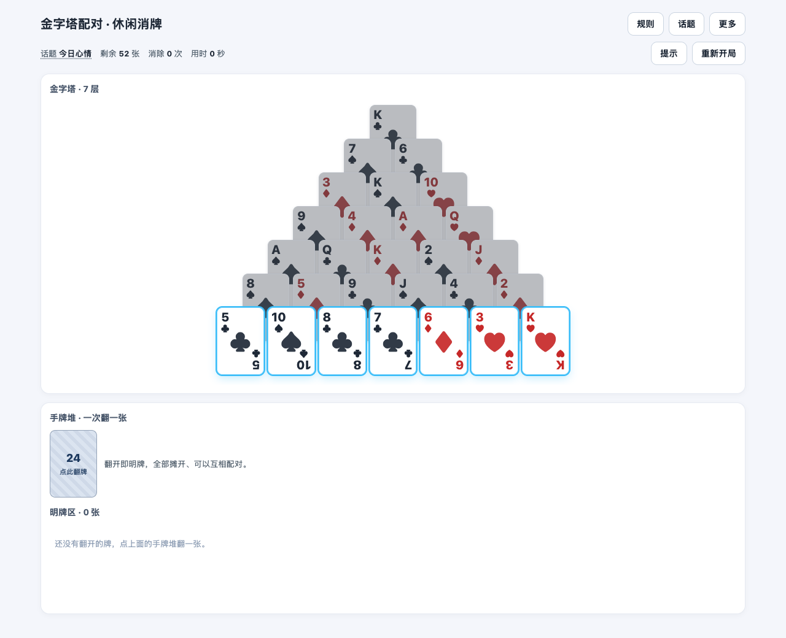
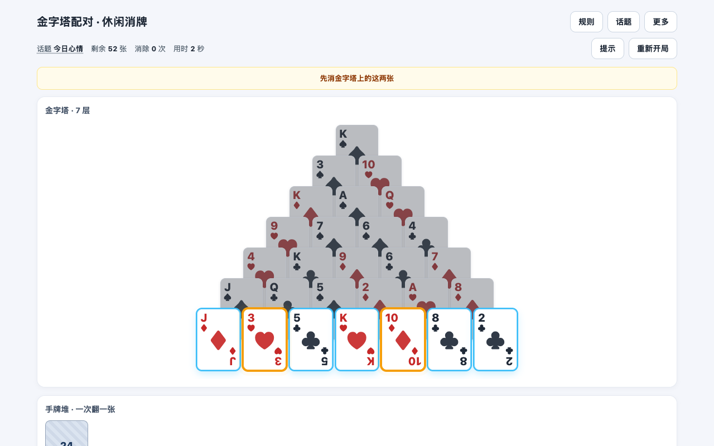
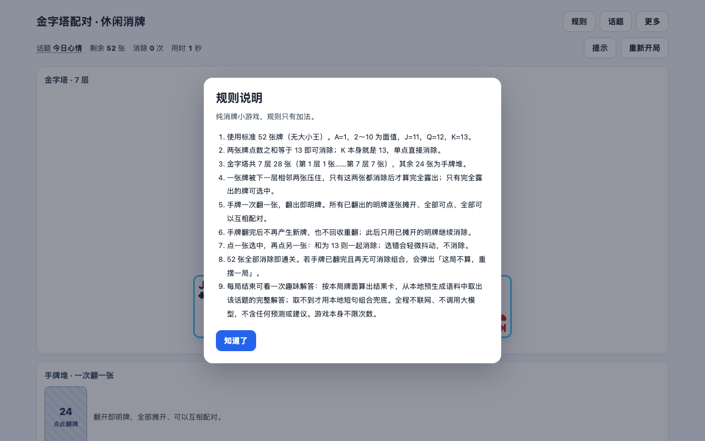
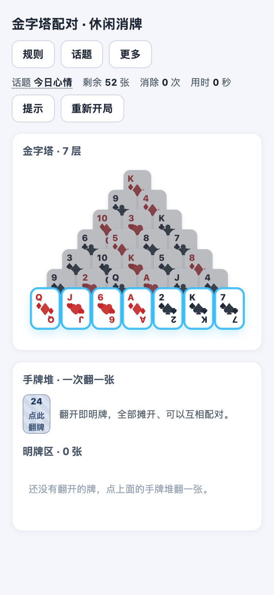

# 金字塔配对 · 休闲消牌

> **一句话定位**：用一副 52 张扑克牌摆成 7 层金字塔、两张凑成 13 就消除的单页休闲小游戏，**仅休闲娱乐**，**打开页面就能玩**，不用注册、不用联网。

**Vue 3.5 · Vite 6 · TypeScript 5.7　|　纯前端 · 零后端 · 零网络请求 · 离线可玩　|　简体中文**



*图 1　打开页面即进入游戏：7 层 28 张金字塔 + 手牌区 + 精简 HUD，0 次点击即可开始消牌。*

## 免责声明<a name="disclaimer"></a>

> 本游戏及趣味解答仅休闲娱乐，不作为真实依据，不具备预测、占卜、判断吉凶的作用，也不构成任何建议或决策依据。
>
> - 规则只有加法，不含任何预测、占卜、宜忌、运势或决策建议；局末「趣味解答」是**本地预生成语料的确定性查表**，同一局面永远得到同一段文字。
> - 全程在浏览器本地运行：不上传话题或输入内容、不请求任何接口、不调用任何大模型；话题记忆只写 `localStorage`。
> - 游戏不限次数、不限天数；隐私模式或禁用存储时静默回落默认话题「今日心情」。

## 目录<a name="toc"></a>

- [免责声明](#disclaimer) · [功能亮点](#features) · [界面预览](#screenshots) · [快速开始](#quickstart)
- [玩法规则](#rules) · [常见问题](#faq) · [验证与质量](#quality) · [项目结构与文档](#structure)
- [已知问题](#known-issues) · [线上版本](#online) · [许可 · 维护 · 反馈](#license)

## 功能亮点<a name="features"></a>

| 亮点 | 说明 |
| --- | --- |
| **每副牌都有解** | 发牌先造合法消除计划再倒推摆牌，保证每局都存在清空金字塔、乃至 52 张全消的走法，不会一开局就注定白玩。 |
| **金字塔优先的「提示」** | 6 档优先级经实时求解器校验，优先推荐金字塔上的可消组合；只高亮 + 一句短文案，**不自动替玩家消除**，不限次、无冷却。 |
| **0 次点击直入游戏** | 打开页面就是棋盘（默认话题「今日心情」），没有开局表单，也没有常驻说明面板。 |
| **说明全部弹窗化** | 规则 / 话题 / 趣味词典 / 免责声明收进顶部三个弹窗，单一弹窗互斥，想看时点开、不看时不占屏幕。 |
| **375px 小屏适配** | 手机宽度下页面无横向滚动，金字塔完整可见；沿用浅色视觉，不换肤。 |
| **纯前端 · 离线可玩** | 零后端、零网络请求、零大模型调用；话题记忆只写 `localStorage`，游戏不限次数、不限天数。 |

提示的 6 档优先级：**塔+塔 > 塔+明牌 > 塔 K 单消 > 明牌+明牌 > 明牌 K 单消 > 翻一张手牌**。只要前 3 档存在保解走法，就不会推荐 4~5 档（明牌区内部组合）；第 6 档「翻一张手牌」只在前 5 档都无保解走法、且手牌未翻完时才提示，避免「有牌可翻却报无提示」。

## 界面预览<a name="screenshots"></a>

<p></p>
<p><em>图 2　点「提示」：优先高亮金字塔上的可消组合，并给出一句话引导（只高亮，不自动消除）。</em></p>
<p></p>
<p><em>图 3　规则 / 话题 / 免责等说明收进顶部弹窗，背景棋盘仍可见。</em></p>
<p></p>
<p><em>图 4　375px 小屏同样无页面级横向滚动，金字塔完整可见。</em></p>

## 快速开始<a name="quickstart"></a>

### 立即试玩

线上版本由 WorkBuddy 已发布的应用承载，打开应用卡片即可玩（见「线上版本」）。本地可克隆仓库后，用任意静态服务器托管**项目根目录**再访问 [`index.html`](index.html)，例如 `python3 -m http.server 8899` 后打开 `http://127.0.0.1:8899/index.html`；直接用 `file://` 打开会被浏览器对 ES module 的 CORS 策略拦截。无需注册、不限次数、全程离线。

### 本地开发

**环境要求：Node.js 22+**（`npm run verify` 依赖 Node 22 原生 type-stripping 直接加载 `.ts`，无需额外安装 tsx / ts-node / vitest 等转译器或测试框架）。另有 `npm run preview`（预览构建）与 `npm run corpus`（重建本地趣味语料）。

```bash
cd frontend
npm install

npm run dev              # 本地开发：vite --host 0.0.0.0
npm run build            # = vite build && node sync.mjs
npm run verify -- 1000   # 批量验证 1000 副牌（不传参数默认也是 1000）
```

1. **关于入口**：**唯一对外、可直接打开的入口是项目根 `index.html`**（引用 `./assets/index-*.js` 与 `./assets/index-*.css`）；`frontend/index.html` 只是 Vite 开发入口（引用 `/src/main.ts`），不对外。
2. **关于产物**：`npm run build` 先构建到 `frontend/dist/`，再由 `frontend/sync.mjs` 把 `dist/index.html`、`dist/assets/` 同步到**项目根**的 `index.html` + `assets/`。因此**只改 `frontend/src/` 而不执行 `npm run build`，对外页面不会有任何变化**；根目录产物由脚本生成，**不要手改**（下次 build 会被覆盖）。

## 玩法规则<a name="rules"></a>

| # | 规则 |
| --- | --- |
| 1 | 标准 **52 张牌**（无大小王）：A=1，2~10 为面值，J=11，Q=12，K=13。 |
| 2 | **两张点数之和 = 13** 即可一起消除；**K 本身就是 13，单点直接消除**。 |
| 3 | 布局为 **7 层 28 张金字塔**（第 1 层 1 张 …… 第 7 层 7 张）+ **24 张手牌**。 |
| 4 | 塔牌被下一层**相邻两张**压住，两张都消除后才算「完全露出」；只有完全露出的牌可选中、可组合（最底层恒露出）。**被压住的 K 同样不可选中、不可单消**。 |
| 5 | 手牌**一次翻一张**，翻出即明牌并**常驻明牌区**：逐张摊开、全部可点、全部可互相配对；翻完后不再产生新牌，也不回收重翻。 |
| 6 | 点一张选中、再点另一张：和为 13 则一起消除；选错只轻微抖动、不消除。 |
| 7 | **52 张全部消除 → 通关**；**手牌已翻完且再无任何可消组合 → 死局**，弹出「这局不算，重摆一局」。 |

> 清空金字塔（28 张全消）是 52 张全消通关的**必要非充分条件** —— 塔清空后明牌区仍可能无解。

## 常见问题<a name="faq"></a>

| 问题 | 回答 |
| --- | --- |
| 这是占卜 / 预测工具吗？ | 不是。规则只有加法，**无预测、无占卜、无判断吉凶、无任何决策建议**；局末「趣味解答」是本地预生成语料的确定性查表，仅休闲娱乐。 |
| 我选的话题、输入的内容会上传吗？ | 不会。全程在浏览器本地运行，**不上传话题或输入内容、不请求任何接口、不调用任何大模型**；话题记忆只写 `localStorage`。 |
| 换设备或换浏览器，话题还在吗？ | 不在。`localStorage` 只属于当前浏览器；隐私模式或禁用存储时会静默回落默认话题「今日心情」，不影响游戏。 |
| 为什么「提示」不直接帮我消掉？ | 提示**只高亮牌 + 给一句短文案**，由你自己点；不限次、无冷却，高亮 8 秒或任意有效操作后自动清除。 |
| 手牌翻完还没凑出组合怎么办？ | 手牌翻完后不再产生新牌、也不回收重翻；若此时再无任何可消组合即判**死局**，弹窗提示「这局不算，重摆一局」，点「重新开局」换一副即可。 |
| 能玩几次？要联网吗？ | **不限次数、不限天数**；纯前端零网络请求，离线也能玩。 |

## 验证与质量<a name="quality"></a>

- `npm run verify -- 1000`：**1000 副牌 100% 结构合法、金字塔可解且 52 张全消可解**，消除计划全部可回放、零兜底、零失败；按提示操作 **20/20** 局清空金字塔。
- `npm run build`：通过，根 `index.html` 与 `assets/` 同步成功、引用资源真实存在。
- 完整核对项、命令退出码与逐项证据见 [`docs/qa-v3-delivery-check.md`](docs/qa-v3-delivery-check.md)；架构与求解细节见 [`docs/architecture-v3.md`](docs/architecture-v3.md)。

## 项目结构与文档<a name="structure"></a>

```text
pyramid-card-match/
├── index.html                 # ★ 唯一对外入口（构建产物，勿手改）
├── assets/                    # ★ 交付产物 JS/CSS（构建产物，勿手改）
├── docs/                      # PRD / 架构 / 类图 / 时序图 / QA 报告 / 截图
├── frontend/index.html        # Vite 开发入口（不对外）
├── frontend/src/              # 源码：game.ts 规则真源、hint.ts、App.vue 等
└── legacy/                    # 旧版单文件留存（历史归档，不参与构建）
```

**文档索引**（全部为仓库内相对路径）

- [`docs/prd-v3-incremental.md`](docs/prd-v3-incremental.md)（PRD）· [`docs/architecture-v3.md`](docs/architecture-v3.md)（架构）· [`docs/class-diagram.mermaid`](docs/class-diagram.mermaid)（类图）· [`docs/sequence-diagram.mermaid`](docs/sequence-diagram.mermaid)（时序图）
- [`docs/qa-v3-delivery-check.md`](docs/qa-v3-delivery-check.md)（QA 报告）· [`docs/readme-benchmark.md`](docs/readme-benchmark.md)（README 对标调研）· [`AGENTS.md`](AGENTS.md)（Agent 约定）

## 已知问题<a name="known-issues"></a>

<details>
<summary>全量 <code>tsc --noEmit</code> 报 <code>TS2307</code>（既有问题，不影响运行与交付）</summary>

`cd frontend && npx tsc --noEmit` 会报 `src/main.ts(2,17): error TS2307: Cannot find module './App.vue'` —— 项目缺 `*.vue` 模块类型声明，属**改动前既有**问题。Vite 用 esbuild 转译且 `noEmit: true`，`npm run build` 正常通过，运行与交付均不受影响。

</details>

## 线上版本<a name="online"></a>

线上版本由 **WorkBuddy 已发布的应用**（应用名：金字塔消牌）承载，内容就是同一份项目根 `index.html` + `assets/` 静态产物；发布为**覆盖更新**，分享链接保持不变。

> 本仓库为**公开仓库**，因此 README **不写入任何带 sharecode 的分享链接，也不含任何密钥**。请以 WorkBuddy 应用卡片或项目维护者提供的入口为准。

## 许可 · 维护 · 反馈<a name="license"></a>

- **许可**：本仓库目前**尚未指定开源许可证**（仓库内未包含 `LICENSE` 文件）。代码虽公开可见，但不代表已授予使用、修改或再分发的许可；如有此类需求，请先通过 GitHub Issues 联系维护者。
- **维护**：个人业余项目，随缘更新；版本演进以 Git 提交历史为准。
- **反馈**：发现规则或显示问题，欢迎到本仓库的 GitHub Issues 反馈。
- **致谢**：Vue 3 与 Vite 让这个纯前端小游戏可以零依赖地跑在浏览器里。
