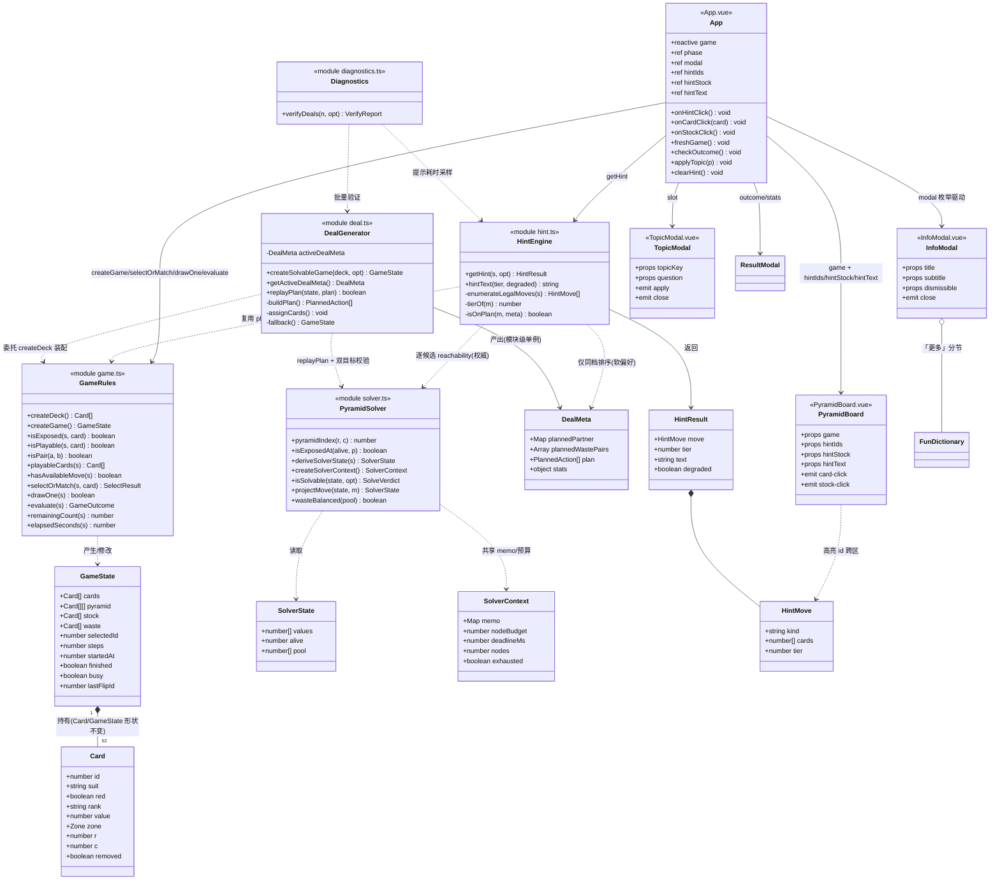
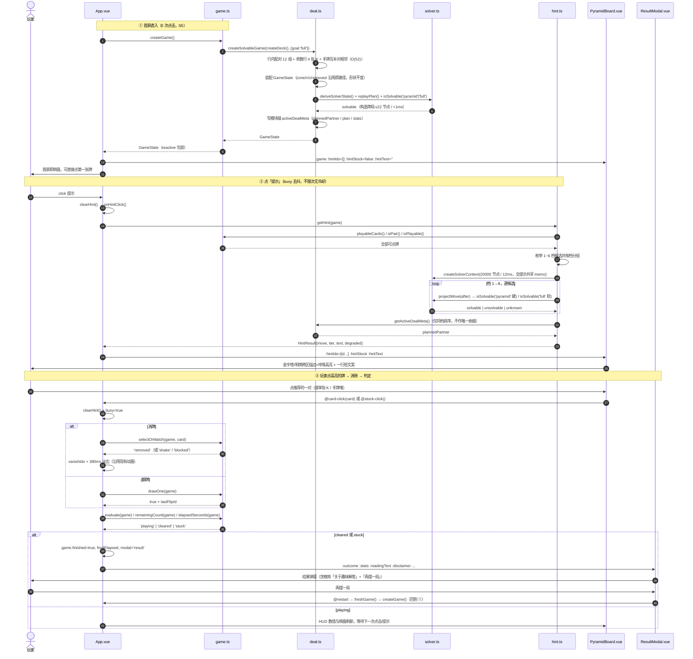
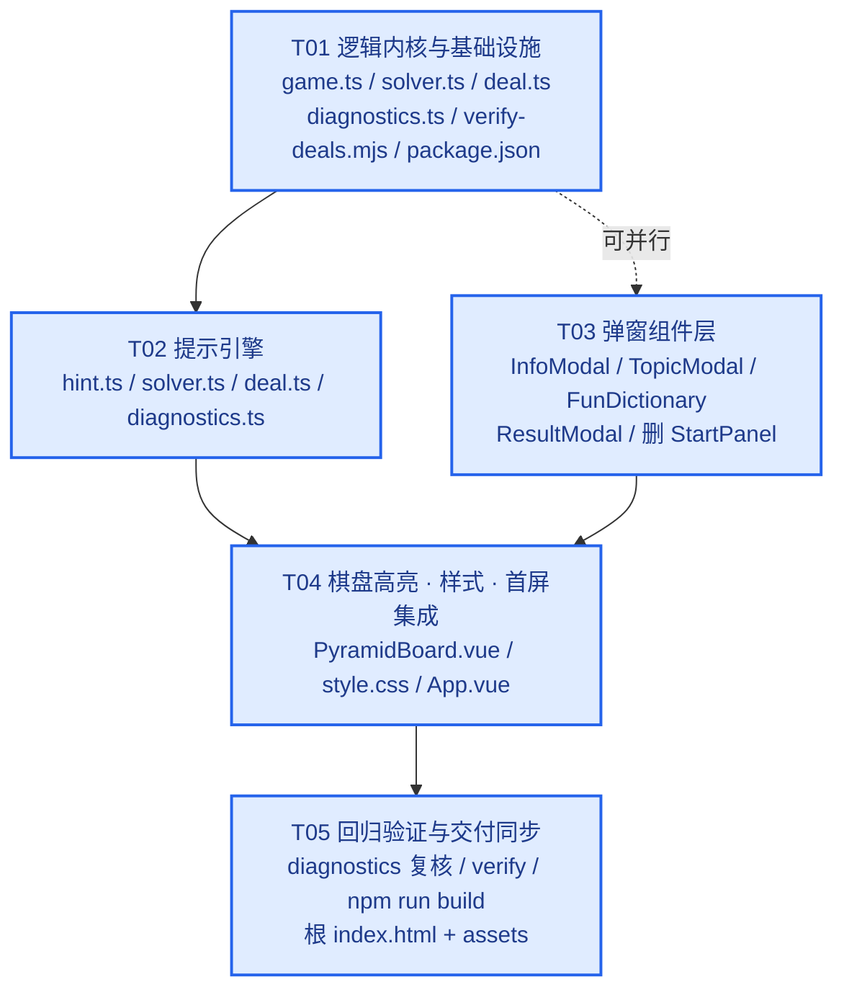

# 金字塔配对 V3 增量 · 系统设计与任务分解

> 架构师：高见远（Gao） / Bob　｜　语言：简体中文　｜　状态：可直接交付工程师编码
> 输入：`docs/prd-v3-incremental.md`（全文已读）、`frontend/src/**`、`frontend/package.json`、`frontend/sync.mjs`
> 本文件**只描述设计**，不含任何源码改动；所有改动由工程师按第 7 节任务列表实施。

| 项 | 内容 |
| --- | --- |
| 技术栈 | Vue 3.5 + Vite 6 + TypeScript 5.7（**沿用，不引入任何新依赖**） |
| 交付入口 | 根 `index.html` + `assets/`（`npm run build` → `sync.mjs`） |
| 红线 | PRD 第 4 节 N1~N9 全部不改；`Card` / `GameState` 形状不改 |
| 核心结论 | **构造式发牌(b) + 松弛位掩码求解器 + 实时 reachability 提示（参考解仅作同档排序）**，全同步、无 Worker |

---

## 0. 结论速览（先看这一张表）

| 难点 | 取舍 | 一句话理由 |
| --- | --- | --- |
| 可解发牌 | **构造式发牌 (b)**，不用「洗牌+验证+重洗 (a)」 | 实测：本变体随机牌局金字塔可解率 **66.90%**，故 200 次重洗统计上其实够；但 (a) 只能给概率保证（S1 硬门槛 100%）、最坏单次求解 38,769 节点 / ~15ms、且**无法塑造提示分布**。(b) 是 O(52) 构造性证明，实测 1000/1000 双目标可解、单局求解 ≤22 节点、约 0.02ms，并顺带白送「52 张全消可解」(P1-1)。 |
| 提示不破坏解 | **实时 reachability 为唯一权威 + 参考解仅作同档排序（混合）** | 参考解单独用会在玩家任意一次偏离后失效、需要重放/重同步、且无法表达「最高档中挑一个保解的」；实时求解无状态、从当前 `GameState` 直接推导，天然自愈，实测每次提示 0.172ms。 |
| 求解器 | **同步纯 TS `solver.ts`，28 位 `alive` + `pool[14]` 位/计数状态** | 金字塔偏序只有 **1430** 个序理想；松弛假设已证明精确（1012/1012 忠实重放 0 失败）；构造牌局每次提示 avg 544 节点 / 0.172ms、max 0.734ms，Worker 的 postMessage 往返反而更慢，且异步加载态会破坏 S5「0 次点击」。 |
| UI | **单一 `modal` 枚举 + 通用 `InfoModal` 壳**；高亮用 `hintIds: number[]` | 金字塔区与明牌区本就在同一个 `PyramidBoard.vue` 内，一个 id 数组即可跨区；单枚举杜绝多弹窗叠加。沿用现有浅色视觉，不换肤。 |
| 兼容 | `game.ts` 全部现有导出签名**逐字不变**，`createGame()` 仅改为委托 | `App.vue` 的 6 个 import 全部继续可用；`Object.assign(game, createGame())` 继续可用。 |

**实测数据（`/tmp/pyramid-analysis*.mjs`，Node 22.22，纯 JS 原型，供架构论证，不属于交付物）**

| 指标 | 值 |
| --- | --- |
| 金字塔偏序序理想数（`alive` 可达状态上界） | **1430** |
| 随机牌局「清空金字塔」可解率（N=3000） | 66.90% |
| 随机牌局「52 张全消」可解率（同一批 N=3000） | 66.90% |
| P(200 次重洗全败) | 9.24e-97 |
| 随机牌局求解节点 avg / max | 1,724 / 38,769（约 0.67ms / ~15ms） |
| 松弛解忠实重放 | 1012 条，**0 失败** |
| 构造式牌局可解率（N=1000，pyramid / full） | **100% / 100%** |
| 构造式牌局单局求解节点 avg / max | **19.7 / 22** |
| 构造式牌局「一次提示」（~14 候选 × 2 目标、无共享 memo 的保守估计） | avg 544 节点 / **0.172ms**，max **0.734ms** |

> 对 PRD「Pyramid Solitaire 随机可解率通常极低」的修正：该结论适用于**标准** Pyramid（有限次回洗、手牌循环有上限）。本游戏的规则是「24 张手牌可随时逐张全部翻出、明牌永久常驻且无手牌上限、K 可单消」，宽松得多，实测约 2/3 可解。这一点如实写在这里，但仍选择 (b)，理由见 1.2。

---

# Part A：系统设计

## 1. 实现方案与框架选型

### 1.1 难点总览

| # | 难点 | 本节 |
| --- | --- | --- |
| 1 | 100% 可解发牌，且不改 `Card`/`GameState`、不卡首屏 | 1.2 |
| 2 | 提示按 6 档严格递减，且**每一步都不走出可解集** | 1.3 |
| 3 | 求解器状态 / 动作 / 记忆化 / 剪枝 / 最坏界限 / 同步性 | 1.4 |
| 4 | 首屏直入、弹窗化、跨区高亮、响应式 | 1.5 |
| 5 | 兼容既有导出与 N1~N9 | 1.6 |

**框架选型**：Vue 3 (`<script setup>` + `reactive/ref/computed`) + Vite 6 + TypeScript 5.7，**零新增依赖**。不引入 React / 状态库 / Tailwind / Web Worker 库 / 求解器库。

- **架构模式**：分层单向依赖 —— `UI 层 (Vue SFC)` → `能力层 (hint.ts / deal.ts)` → `内核层 (solver.ts)` → `规则层 (game.ts)`。`game.ts` 是唯一规则真源，其余模块只读复用 `playableCards()/isPair()/isExposed()`，不重写规则（PRD 交付约束 2）。
- **依赖方向**：`game.ts` 在运行时只依赖 `deal.ts`；`deal.ts`/`solver.ts` 对 `game.ts` **只有 `import type`**（编译期擦除），因此**不存在运行时循环依赖**。
- **文件内 import 约定**：所有新增 `.ts` 的相对导入**显式写 `.ts` 后缀**（`tsconfig.json` 已开 `allowImportingTsExtensions: true`，`corpus.ts` 已是此风格）。目的：Node 22 原生 type-stripping 可直接 `node frontend/scripts/verify-deals.mjs` 跑 QA 批量验证，无需 esbuild / tsx / ts-node，**不引入新依赖**。已在本机 Node v22.22.2 验证通过。

---

### 1.2 难点一：可解牌局生成（(a) vs (b) vs (c)）

#### 路径 (a)：随机洗牌 + 求解器验证 + 重洗

- 流程：`shuffle(createDeck())` → 求解器判可解 → 不可解则重洗，上限 200 次 / 300ms → 仍失败用兜底牌。
- **实测结论要诚实**：本变体可解率 66.90%，期望 1.5 次即命中，`P(200 全败)=9.24e-97`，**200 次重洗在统计上远远够用**；PRD 里「极低」的先验来自标准 Pyramid，不适用于本项目。
- 但仍**否决**，五条理由：
  1. **S1 是 100% 硬门槛**。(a) 是概率保证；一旦叠加「300ms 超时」这个实际约束，允许的重洗次数骤降，就存在「超时后发了一副未验证/不可解的牌」的尾部风险；验收必须额外测兜底分支。(b) 是构造性证明，0 次重洗。
  2. **首屏成本不可控**。随机牌局求解 avg 1,724 节点、max 38,769 节点（~15ms）；悲观连败时 200× 上限理论上可达秒级，必须加超时截断，与「绝不阻塞首屏」相冲突。
  3. **(a) 无法塑造提示分布**。随机可解牌局的解往往依赖大量「金字塔 + 明牌」甚至明牌清理，首屏可能连续推荐十几档 6「翻牌」，与用户「应尽可能优先组合金字塔上的牌」直接相悖。(b) 可保证**整座金字塔只靠档 1 / 档 3 就能清空，一次手牌都不用翻**。
  4. **(a) 不白送 P1-1**。要「52 张全消可解」得再跑一个更严格目标；(b) 构造时天然满足（实测 1000/1000）。
  5. **(a) 不产出参考解**给同档排序用（虽有解路径，但还要额外存）。

#### 路径 (c)：构建期预生成牌库（额外评估，否决）

构建时批量生成 1000 副可解牌存成静态 JSON，运行时随机取一副。否决：多一个构建产物与 `sync.mjs` 同步负担、牌局有限可枚举、失去「每次都是新牌」的自然感，而 (b) 已只需 0.02ms，没有收益。

#### ✅ 选定路径 (b)：构造式发牌（先造合法消除序列，再倒推摆牌）

**核心构造：行内配对 + 奇数行 1 张 K + 手牌互补对相邻。** 先定「消除计划」，再把真实 52 张牌填进 28 个塔位与 24 张手牌序列。

```
输入 deck = createDeck()（52 张，value 1..13 各 4 张，花色各异）
1) 按 value 分桶 buckets[v]（每桶 4 张 Card，先 shuffle 保证花色观感随机）
2) 生成塔位配对计划：
   for r = 0..6:
     P_r = [idx(r,0)..idx(r,r)]，shuffle
     if |P_r| 为奇数: kPos.push(P_r.pop())      // r=0,2,4,6 → 恰好 4 个 K 位
     否则/剩余: 两两成对，共 12 个 pyramid 配对
   校验 pairs.length===12 && kPos.length===4 && pairs+kPos 覆盖 28 个塔位各一次
3) 构造 12 个互补类：v=1..6 各生成 2 个 [v, 13-v] → 12 个，shuffle
   for i in 0..11: (a,b)=class[i]; flip=coin()
      pairs[i][0] ← (flip ? a : b) ; pairs[i][1] ← (flip ? b : a)
      plannedPartner[cardId0] = cardId1 ; plannedPartner[cardId1] = cardId0
   → 金字塔用掉 value 1..12 各 2 张
4) 4 个 K 位 ← value 13（plannedPartner[cardId] = null）
5) 剩余：value 1..12 各 2 张 = 24 张，正好是手牌
   手牌顺序按 [v,13-v] 互补对相邻排列（12 对之间 shuffle，对内不打散）
   → plannedWastePairs = 12 个 [cardId, cardId]
6) 装配 GameState：完全沿用 game.ts 现有装配（zone/r/c/removed/startedAt/busy/lastFlipId），
   仅把 cards 的 52 个位置换成「28 塔位 + 24 手牌」的构造顺序；suit/red/rank 由 bucket 的真实 Card 带入。
7) 构造性校验（O(28)，不依赖求解器性能）：
   replayPlan(state, plan) 必须 alive===0；goal==='full' 时还须 wasteBalanced(pool)
   再做一次 isSolvable('pyramid') / isSolvable('full') 双确认（构造牌局实测 ≤22 节点）
8) 写模块级 activeDealMeta，返回 state
```

**为什么这个构造天然合法（逐条回应 PRD 约束）**

| 约束 | 保证方式 |
| --- | --- |
| 52 张无重复无遗漏 | 从 `createDeck()` 的 4 桶 ×13 点数逐一 `pop()`；第 3 步用掉 1..12 各 2 张，第 4 步用掉全部 4 张 K，第 5 步剩余 1..12 各 2 张 = 24 张。装配后 `diagnostics.ts` 再断言每点数恰好 4 张、`cards.length===52`。 |
| 金字塔 7 层 28 位 | 仅复用 `game.ts` 现有 `for r=0..6, c=0..r` 的装配循环，`r/c` 坐标不变，`isExposed()` 完全不改。 |
| 露出 / 压住约束 | 消除计划按 **r=6→0 自底向上逐行**执行，且每行只在该行全部下层清空后才开始：此时该行全部牌都「完全露出」（`isExposed` 为真）。同层内互配不会互相遮挡，故 12 个 `pairPP` 全部同时合法。 |
| K 单消 + 被压住的 K 不可消 | 4 张 K 恰为 4 个奇数行的「落单牌」，按行序到达时其两个子牌已全部消除 → 已完全露出，合法单消；构造中**不存在**被压住的 K 被提前消的情况。运行时仍由 `selectOrMatch` 原有顺序保证（N2 不动）。 |
| 手牌翻牌顺序 & 明牌常驻可点 | 松弛等价定理（1.4）保证「把全部 draw 前置」不损失可解性；真实游戏中玩家随时可点手牌堆逐张翻，翻出即 `waste` 常驻。手牌按互补对相邻排列只是**体验优化**：金字塔清空后每翻 2 张即得一个档 4 组合，不会出现长的「只翻牌」空窗。 |
| `Card`/`GameState` 形状 | 装配走原路径，一个字段都不加；参考解放 `deal.ts` 的模块级变量（见 1.3）。 |
| 复杂度 / 首屏 | 构造 O(52)；校验 O(28)；求解器双确认 ≤22 节点。实测整局创建 < 1ms。**同步执行，不卡首屏**。 |
| 失败兜底（Q2） | 三级防御，见下。 |

**兜底（绝不阻塞首屏，PRD Q2 / P0-1③）**

| 级 | 触发 | 行为 |
| --- | --- | --- |
| L1 | 正常 | 构造 + `replayPlan` + 双目标 `isSolvable` 通过 → 返回 |
| L2 | L1 抛异常 / 校验不过 / 超过 `deadlineMs`(默认 40ms) | 用**固定种子 RNG** 重跑一次构造（确定性、必成功），`DealMeta.stats.fallback=true` |
| L3 | L2 仍异常 | 退回旧版纯 Fisher-Yates `shuffle(createDeck())` + 原装配，`plannedPartner` 置空，`console.warn('[deal] fallback to legacy')`。`createGame()` 外层再包 `try/catch`，**保证永不抛异常**，首屏一定可点牌。 |

> Q2 的「200 次重洗 / 300ms」在 (b) 下已无重试循环；仍保留 `maxAttempts=3`（构造重试，非洗牌重试）、`deadlineMs=40` 与 L3 兜底，语义对齐 PRD 且不浪费。

**目标选择（Q1 明确取舍）**：`DealOptions.goal` 默认 **`'full'`（52 张全消可解）**，因为构造已经白送、成本为 0，可直接满足 P1-1 并让 S4 具备 20/20 的潜力；但**提示的硬校验仍用 `'pyramid'`**（严格 D1），`'full'` 只作同档软偏好。这样既不会因为追求全消而拒绝玩家「明明能消的两张金字塔牌」（用户原话诉求），又能温和地把 S4 拉高。见 1.3。

---

### 1.3 难点二：提示不破坏可解路径

#### 两条路的评估

| | A. 发牌时记录参考解，提示沿参考解走 | B. 每次实时求解 reachability |
| --- | --- | --- |
| 单次成本 | O(1) | 实测 0.172ms（构造牌局） |
| 玩家偏离后 | **立刻失效**，需做「状态哈希比对 → 重放 → 重同步」或重新搜索；偏离检测本身易错 | **无需任何重算逻辑**：`deriveSolverState(liveGameState)` 每次从当前真实局面重推，天然自愈 |
| 表达「高优先级但会走死 → 跳过降级」 | 表达不了（参考解只有一条路，且这条路的档位未必是最高档） | 直接表达：逐档逐候选做「走完这步还是否可解」 |
| 玩家乱点导致牌局无解 | 无从判断，容易误报「无提示」 | 可显式识别并降级（见下） |
| 存储 | 需挂在某处；挂 `GameState` 会违反 P0-1④ | 无持久化状态 |
| 实测 | — | 1430 个 `alive` 理想 + 记忆化，构造牌局 544 节点 / 0.172ms |

#### ✅ 选定：**B 为唯一权威，A 退化为「同档排序的软偏好」（混合）**

- `deal.ts` 在模块级保存 `activeDealMeta`（`plannedPartner: Map<cardId, cardId|null>`、`plannedWastePairs`、`plan`、`stats`），`createGame()` 每次调用即刷新；`hint.ts` 通过 `getActiveDealMeta()` **只读**。
  - 由于 `App.vue` 用的是 `reactive(createGame())` + `Object.assign(game, createGame())`，若把 meta 挂到 `GameState` 上会踩 Vue Proxy / 覆盖问题，也会违反 P0-1④；模块级单例（全场只有一副活动牌）最干净，且不参与响应式。
- **参考解永远不绕过硬校验**：每个候选走法仍要过 `isSolvable(after, 'pyramid')`；`plannedPartner` 只在**同一档内**参与排序，把提示温和地拉回计划路径（保护 S4）。
- **玩家偏离后如何重算 → 不需要重算**。这是本方案最大的简化点：求解器是无状态纯函数，`alive` 来自当前 `state.pyramid[].removed`，`pool` 来自当前 `state.stock ∪ state.waste`。偏离越大，`plannedPartner` 命中越少，自动退化为纯 B；没有「重新搜索 / 重放 / 增量求解」的分支。

#### 提示算法（`hint.ts` 伪码，工程师照此实现）

```
getHint(s, opt):
  ctx = createSolverContext(nodeBudget=20000, deadlineMs=12)   // 一次提示内共享 memo 与总预算
  base = deriveSolverState(s)          // values[28] + alive(28bit) + pool[14]
  meta = getActiveDealMeta()
  legal = enumerateLegalMoves(s)       // 复用 playableCards / isPair / isPlayable；去重无序对

  for tier = 1..6:
    cands = legal.filter(m => tierOf(m) === tier)
    if cands.empty: continue
    scored = []
    for m of cands:
      after = projectMove(base, m)                     // 纯函数，绝不修改 s
      hard = isSolvable(after, {goal:'pyramid', context:ctx})
      if hard === 'unsolvable': continue               // ★ P0-3：跳过会走死的走法，降级
      soft = isSolvable(after, {goal:'full', context:ctx}) === 'solvable'
      onPlan = isOnPlan(m, meta)
      scored.push({ m, soft, onPlan })
    if scored.length:
      scored.sort( onPlan desc → soft desc → cardId asc )       // 参考解 / 全消仅作同档软偏好
      return { move: scored[0].m, tier, text: hintText(tier,false), degraded:false }

  // 1~6 档都没有「保解」候选：说明玩家自由乱点已把局面走出可解集
  if legal.length:
    return { move: bestOf(legal), tier: tierOf(bestOf(legal)), text: hintText(0,true), degraded:true }
  return { move:null, tier:0, text:'这局没有可消的组合了', degraded:true }
```

- **档位映射 `tierOf`**：`pair(两塔)`=1、`pair(塔+明)`=2、`singleK(塔)`=3、`pair(明+明)`=4、`singleK(明)`=5、`draw(stock>0)`=6。K 不能参与 `isPair`（13 无互补值），天然只出现在 3/5 档。
- **为什么严格满足「1~3 档有解就不得推荐 4~5」**：外层 `for tier=1..6` 一旦在某一档找到**保解**候选就立即返回；只有该档所有候选都 `unsolvable` 或本档无候选才继续。这正是「高优先级走法若会走死后续解要跳过降级」的字面实现。
- **为什么 S2/S3 成立（归纳证明）**：初始局面由构造保证 `isSolvable('pyramid')=true`；提示只挑 `hard !== 'unsolvable'` 的动作 ⇒ 走完后仍可解；反复 ⇒ 必到达 `alive===0`。又因「可解」蕴含下一步必有合法消除动作（若 `stock` 已空，解的下一动作不可能是 draw），`evaluate()` 不会提前判 `stuck` ⇒ **S3 = 0 次**。
- **`unknown` 的乐观处理**：预算/超时耗尽时 `isSolvable` 返回 `'unknown'`，`hard` 判定用 `!== 'unsolvable'`（把 unknown 视为可用），**绝不出现「仍有合法走法却报无提示」**（PRD 3.4）。参考解与同档排序同时兜住质量。
- **档 6 的 `projectMove`**：松弛状态下 `pool` 已含所有未翻手牌，翻一张牌只是把卡从「未翻」挪到「明牌」，`(alive, pool)` **不变**，因此 `isSolvable` 前后相同 —— 与「翻牌恒无害」一致，档 6 天然保解。
- **`degraded=true` 的产品行为（PRD 未定义，本设计给出默认建议，见 Q11）**：不弹阻塞、不自动作弊、不新增按钮。提示照常高亮当前最高档合法走法，文案改为「这副牌已经走不到清空金字塔了，重新开局可以换一副」；`evaluate()` 保持原样（N8），玩家自然走到结果弹窗。

#### 文案表（`hintText`，一行短句，按需出现不常驻）

| 档 | 文案 |
| --- | --- |
| 1 / 2 | 先消金字塔上的这两张 |
| 3 | 金字塔上的 K 可以直接点掉 |
| 4 / 5 | 金字塔暂时配不上，先消明牌这两张 |
| 6 | 金字塔暂时配不上，先翻一张手牌 |
| 0（降级） | 这局没有可消的组合了 / 这副牌已经清不掉金字塔了，重新开局可以换一副 |

---

### 1.4 难点三：求解器状态表示、剪枝与同步性

#### 松弛等价定理（本设计的理论基石）

> **定理**：对「清空金字塔」与「52 张全消」两目标，把「所有尚未翻出的手牌可随时一次性全部翻出」视为已翻出，**不改变可解性**。
> **证明**：① `drawOne()` 在 `stock` 非空时恒合法且单调（无回收重翻）；② 翻出的明牌永久常驻、全部可点、不遮挡任何金字塔牌、无手牌上限、也不被强制消除 ⇒ 只会**增加**可用动作，绝不会减少；③ 故任意真实解可把其中全部 draw 动作前置到最开始仍合法；④ 反之松弛解把 draw 全部前置即为真实解。`evaluate()` 只在 `stock.length===0 && !hasAvailableMove` 判 `stuck`，而可解路径上必存在合法动作，不会被提前判死。
> **实测**：1012 条松弛解在忠实重放器（按真实 `drawOne`/`isExposed`/`isPair` 语义）下 **0 失败**。
> **推论**：状态**不需要 `drawn` 字段**，`pool = count(s.stock ∪ s.waste)` 即可，状态空间塌缩一个维度。

#### 动作集合归约定理

> 对「清空金字塔」，搜索中**完全忽略**「明牌+明牌」「明牌 K 单消」动作（不减少塔牌、只消耗资源，永不可能是必要步骤）。对「52 张全消」，这两类动作可无损推迟到 `alive===0` 之后一次性清算，条件为剩余明牌 `pool[v]===pool[13-v]`（v=1..6），K 恒可单消 ⇒ 只需在终点做 O(6) 的 `wasteBalanced()` 检查。
> 故动作集合只剩 3 类：`singleK(p)` / `pairPP(p,q)` / `pairPW(p,v)`，分支数大幅下降。

#### 状态编码（放在 `frontend/src/solver.ts`）

| 字段 | 类型 | 说明 |
| --- | --- | --- |
| `values` | `number[]`（28） | 静态，按 `pyramidIndex(r,c)=r*(r+1)/2+c` 存塔牌点数；`Card.value` 永不变化，任何时刻可从 `s.pyramid[r][c].value` 读出 |
| `alive` | `number`（28 位） | `1` = 该塔位牌仍存在；最大 `2^28-1` 落在 32 位正整数内，可直接用位运算 |
| `pool` | `number[]`（14） | `pool[v]` = 当前**可用明牌**中点数为 v 的张数（含所有未翻手牌）；下标 0 不用，1..13 |
| `childrenMask` | 静态 `number[28]` | 预计算：`p=(r,c)` 被 `(r+1,c)`、`(r+1,c+1)` 压住；`r=6` 为 0。`isExposedAt(alive,p) = (alive>>p & 1) && (alive & childrenMask[p])===0`，与 `game.ts::isExposed` 语义一一对应 |

**记忆化 key**：`` `${alive}|${pool.slice(1,13).join('')}` `` → `Map<string, SolveVerdict>`，`SolveVerdict = 'solvable'|'unsolvable'|'unknown'`。`alive` 的可达值只有 **1430** 个序理想（实测），`pool` 每个分量 ≤4 且单调递减，实际访问状态数极小。

**剪枝策略（8 条，全部必做）**

1. 只枚举 `isExposedAt` 为真的塔牌。
2. **露出的塔 K 立即单消**（规范化/支配规则）：不消耗资源、只解锁上层，永不劣化 ⇒ 每个 DFS 节点先吸收全部可单消 K，再算 key，显著压缩状态。
3. 只考虑「至少消去一张塔牌」的 3 类动作（见归约定理），`draw` 不进搜索。
4. `pairPP` 用 `p<q` 去重；`pairPW` 仅当 `pool[13-v]>0`。
5. `'pyramid'` 目标在 `alive===0` 立即 `true`；`'full'` 目标再查 `wasteBalanced()`（6 次比较）。
6. 记忆化**失败态与成功态**（成功态可短路）。
7. **一次提示共享 `SolverContext`**：所有候选走法的 `isSolvable` 共用一个 `memo`、一个总 `nodeBudget=20_000`、一个总 `deadlineMs=12`；耗尽后返回 `'unknown'`。deal 校验用更宽的 `50_000 / 40ms`。
8. 候选走法用 `projectMove()` 生成**新的** `SolverState`（`pool.slice()` 复制），绝不修改 `s`。

**Worst-case 界限**

- 理论上界：`1430 (alive 理想) × ∏(pool[v]+1) (消耗多重集)`，但被 `nodeBudget` 硬截断，且实测构造牌局 ≤22 节点、随机牌局 max 38,769 节点。
- **单次提示实测**：avg 14.2 个候选、544 节点、**0.172ms**，max **0.734ms**；共享 memo 后只会更低。
- **硬上限**：`nodeBudget=20_000` + `deadlineMs=12` ⇒ 单次 `getHint()` 最坏 ≤12ms（远低于一帧 16ms 的感知阈值），且 `busy` 期去抖，动画期不触发。
- **首屏**：`createGame()` = 构造 O(52) + 校验 O(28) + ≤22 节点求解 ⇒ < 1ms。

**同步还是异步？——同步，不用 Web Worker / 分片 / 预生成**

| 方案 | 结论 |
| --- | --- |
| **同步纯 TS（选定）** | 0.02ms（发牌）/ 0.172ms（提示）实测；无加载态、无竞态、无 `postMessage`；`base:'./'` + `sync.mjs` 复制到根目录的产物路径不受影响；`solver.ts` 无 DOM/网络依赖，可被 Node 直接跑 QA。 |
| Web Worker | 否决：Worker 往返 `postMessage` 通常 >1ms，**比计算本身还慢**；`new Worker(new URL('./solver.worker.ts', import.meta.url), {type:'module'})` 在 `base:'./'` + 根 `assets/` 同步部署下需要额外处理 URL；异步会让「首屏 0 次点击」出现中间态；且把纯函数拆成消息协议大幅增加复杂度。 |
| 时间分片（requestIdleCallback） | 否决：提示是用户点击后的即时反馈，分片会引入延迟与「高亮迟到」；且没有必要。 |
| 构建期预生成 | 否决：见 1.2 路径 (c)。 |

> **回归逃生门**：若 QA 实测 `getHint()` P99 > 8ms（例如未来放开难度），再把 `isSolvable` 整体搬进 Worker 只需替换 `hint.ts` 中一处调用为 `async`（`SolverContext` 已是纯数据，可结构化克隆）；架构不阻塞这条迁移。

---

### 1.5 难点四：UI 结构

#### 组件拆分与 props / emits 约定

| 组件 | 新增/改 | props | emits | 职责 |
| --- | --- | --- | --- | --- |
| `App.vue` | 改 | — | — | 单一状态源 `reactive(createGame())`；`phase` 初值 `'playing'`；统一 `modal` 枚举；提示接线；HUD；结果/规则/更多弹窗容器 |
| `PyramidBoard.vue` | 改 | `game: GameState`、`vanishIds: number[]`、`shakeIds: number[]`、`flipId: number\|null`、**`hintIds: number[]`**、**`hintStock: boolean`**、**`hintText: string`** | `card-click(card)`、`stock-click()` | 金字塔 7 层 + 手牌堆 + 明牌区（**两个区域在同一组件内**）；`stock-note` 压成一行 |
| `InfoModal.vue` | 新 | `title: string`、`subtitle?: string`、`dismissible?: boolean`（默认 true） | `close()` | 通用弹窗壳：遮罩、`@click.self`、Esc 关闭、`role="dialog" aria-modal`、右下「知道了/关闭」 |
| `TopicModal.vue` | 新（替代 `StartPanel.vue`） | `topicKey: string`、`question: string` | `apply({topicKey, question})`、`close()` | 3 组 14 chip + hint + 200 字文本框 + `checkQuestion` 校验 +「应用话题」；**不重置牌局**（Q3） |
| `FunDictionary.vue` | 改 | — | — | 去掉 `<details>/<summary>` 折叠壳，改为两个分节 + `DICT_DISCLAIMER`，供「更多」弹窗嵌入；内容全文保留 |
| `ResultModal.vue` | 改 | 现有 8 个 props **全部不变** | 现有 `restart` / `reading` **不变** | 追加一行精简「关于趣味解答」（Q8）；其余文案/统计/打字机不动 |
| `ReadingCard.vue` / `readings.ts` / `corpus.ts` / `data/reading-corpus.ts` | **不动** | — | — | N5 / N6 红线 |

**弹窗统一管理：单一枚举（明确取舍）**

```ts
type ModalKey = 'none' | 'rules' | 'topic' | 'more' | 'result'
const modal = ref<ModalKey>('none')
```

- 否决「多个布尔（`showRules`/`showTopic`/`showMore`/`showResult`）」：会出现两个遮罩叠加、Esc 不知道关哪个、结果弹窗期间还能开规则弹窗等竞态。单枚举天然互斥，一个 `closeModal()` 收敛所有出口。
- `'result'` 特殊规则：**不可**遮罩点击 / Esc 关闭（与现有 `ResultModal` 一致，只能「再摆一局」/「看看趣味解答」）；其余三类可关闭。
- 打开任意 `rules/topic/more` 时清空提示高亮；`checkOutcome()` 判 `cleared|stuck` 时**强制** `modal='result'`（覆盖当前弹窗）。
- 首屏 `modal='none'`、`phase='playing'` ⇒ S5：0 次点击、常驻说明文字 ≈ 0。

**提示高亮如何跨两个区域**

- `PyramidBoard.vue` 同时渲染金字塔与明牌区，`Card.id` 全局唯一 ⇒ 一个 `hintIds: number[]` prop 在 `cls(card)` 里加 `'hint': props.hintIds.includes(card.id)`，即可**跨区同时高亮**；不需要 provide/inject、不需要事件总线、不需要在 App 层分别下发。
- 档 6 用 `hintStock: boolean` → `.stock-btn.hint`。文案 `hintText: string` 渲染在棋盘上方 `.hint-banner`（按需 `v-if`，不常驻）。
- CSS：`.card.hint` = 2px 琥珀描边 + `box-shadow` 呼吸动画（`@keyframes hintPulse`）；`.stock-btn.hint` 同款。**不覆盖** `.playable` / `.selected` / `.blocked` 的既有视觉，用更高 `z-index` 叠加。
- 清除时机：任何有效操作（`@card-click` 非 ignored、`drawOne` 成功、`freshGame`、`openModal`）= `clearHint()`；另设 8s 自动清除定时器，`onBeforeUnmount` 清理；`game.busy` 期间 `@click` 去抖（Q5 不限次、无冷却）。

**首屏线框落地（对齐 PRD 3.5.1）**

```
标题 + [规则][话题][更多]                 ← 顶部条，3 个小按钮
话题 今日心情 · 剩余 52 · 消除 0 · 用时 0s   [提示][重新开局]   ← HUD，共 5 个按钮以内
[ hint-banner：一行短句，按需出现 ]
金字塔 7 层 28 张（居中主视觉）
手牌堆 [24] 点此翻牌   |   明牌区 · 0 张（翻出即常驻摊开）
```

- **删除**：`.disclaimer-bar`、`StartPanel` 首屏、`side-panel`（本局话题 / 关于趣味解答）、底部 `FunDictionary` 常驻、`backToStart`「换个话题」按钮、`form-note` 大段。
- **移入弹窗**：规则 9 条全文（去掉弹窗内重复的 `DISCLAIMER` 行）｜话题 14 chip + hint + 文本框 + 校验 +「应用话题」｜更多 = `FunDictionary` 全文 + `DICT_DISCLAIMER` + `DISCLAIMER` 全文。
- **Q3/Q4**：`applyTopic` 只更新 `topicKey`/`question`/`topicLabel`，**不调用 `freshGame()`**；默认 `mood`。P1-2（记住上次话题）作为低成本可选项：`localStorage` 读写包 `try/catch`，失败静默回落 `mood`。
- **Q8**：「关于趣味解答」精简一句并入 `ResultModal` 底部说明（不进「更多」，避免两处重复）。
- **N7**：本轮扫描到唯一外链是 `legacy/index.html` 里的 Tailwind CDN（历史归档、不参与构建）；**`legacy/` 一律不碰**，且不得删除任何既有 `<a href>`。若另有产品侧指认的入口，保持原样。

**响应式与主题（明确取舍）**

- **沿用 `style.css` 现有浅色视觉**（`--card-w/--card-h` clamp、`#f4f6fb` 底、白卡、蓝主色、红/黑花色）。IDE 是 dark 主题，但**不整体换肤、不引入 prefers-color-scheme 切换**——PRD 要的是「精简」，换肤会扩大回归面且非本轮目标。
- 只做：删掉不再使用的 `.disclaimer-bar` / `.side-panel` / `.layout` 双栏 / `.start-card` 大段 / `.fun-dict details` 相关样式；新增 `.hint` / `.hint-banner` / `.modal-section` / `.topbar` 两行布局；保留并微调 `@media (max-width:900px)` 与 `(max-width:640px)`，小屏下 HUD 独占一行、`.modal{max-height:92vh}`、`.hint-banner` 可换行。
- `.chip` / `.chip-hint` / `.q-input` / `.form-error` / `.rules-list` / `.dict-grid` / `.dict-note` 等**复用现有类**，话题弹窗与更多弹窗直接沿用，几乎不写新 CSS。

---

### 1.6 难点五：兼容与回归（必须逐字保持不变的契约）

**`game.ts` 现有导出签名全部保持不变**（`App.vue` 及 QA 依赖）：

```ts
export type Zone = 'pyramid' | 'stock' | 'waste'
export interface Card { id:number; suit:string; red:boolean; rank:string; value:number; zone:Zone; r:number; c:number; removed:boolean }
export interface GameState { cards:Card[]; pyramid:Card[][]; stock:Card[]; waste:Card[]; selectedId:number|null;
  steps:number; startedAt:number; finished:boolean; busy:boolean; lastFlipId:number|null }
export type SelectResult = 'selected'|'deselected'|'removed'|'shake'|'blocked'|'ignored'
export type GameOutcome = 'playing'|'cleared'|'stuck'

export function createDeck(): Card[]
export function shuffle<T>(arr: T[]): T[]
export function createGame(): GameState            // 签名不变；语义改为「构造式可解发牌」
export function isExposed(s: GameState, card: Card): boolean
export function isPlayable(s: GameState, card: Card): boolean
export function isPair(a: Card, b: Card): boolean
export function playableCards(s: GameState): Card[]
export function hasAvailableMove(s: GameState): boolean
export function remainingCount(s: GameState): number
export function selectOrMatch(s: GameState, card: Card): SelectResult
export function drawOne(s: GameState): boolean
export function evaluate(s: GameState): GameOutcome
export function elapsedSeconds(s: GameState): number
```

- **只改 `createGame()` 的函数体**：`return createSolvableGame(createDeck())`（外层 `try/catch` + L3 兜底）。其余函数**一行不改**（N1~N4、N8）。
- `Card` / `GameState` / `Zone` / `SelectResult` / `GameOutcome` **字段一个不加、一个不删、类型不变**（P0-1④）。
- `App.vue` 现有 6 个 import `createGame, drawOne, elapsedSeconds, evaluate, remainingCount, selectOrMatch` 继续有效；仅**新增** `import { getHint } from './hint.ts'`。
- **新增 API 全部是加法**，且新模块对 `game.ts` 只有 `import type`，无运行时循环依赖：
  `createSolvableGame()` / `getActiveDealMeta()` / `deriveSolverState()` / `isSolvable()` / `getHint()` / `hintText()` / `verifyDeals()`。
- **`Object.assign(game, createGame())` 继续可用**：`createGame()` 仍返回纯对象；`activeDealMeta` 是 `deal.ts` 模块级普通变量，不进 Vue 响应式，`freshGame()` 无需额外 `reset()`。
- **N5/N6 红线**：`readings.ts`（含 `DISCLAIMER`/`DICT_DISCLAIMER`/`REPLAY_LINES`/`TOPICS`/`FUN_RANKS`/`FUN_SUITS`/`checkQuestion`/`buildReading`）、`corpus.ts`、`data/reading-corpus.ts`、`ReadingCard.vue` 一律不改；免责字符串**只改展示位置、不改字**。
- **N9**：`npm run build` + `sync.mjs` 流程不改；仅要求交付前执行一次，根 `index.html` + `assets/` 为唯一对外入口。
- **回归自检清单**：`tsc --noEmit`（隐式）、构建无报错；旧调用 `createGame()` 手工点 3 步仍走 `selectOrMatch` 原逻辑；`evaluate()` 三种返回值不变；结果弹窗与趣味解答「每局一次」不变。

---

## 2. 文件列表（相对项目根）

| # | 路径 | 状态 | 职责 |
| --- | --- | --- | --- |
| 1 | `frontend/src/solver.ts` | **新增** | 纯同步求解器：`SolverState`/`SolverContext`、`deriveSolverState`、`isSolvable`、`projectMove` 辅助、`wasteBalanced`、静态 `childrenMask`；无 DOM、无网络、无 `.vue` 依赖 |
| 2 | `frontend/src/deal.ts` | **新增** | 构造式发牌 `createSolvableGame()`、三级兜底、模块级 `activeDealMeta`、`replayPlan()`、`getActiveDealMeta()` |
| 3 | `frontend/src/hint.ts` | **新增** | 6 档枚举 / 排序 / 文案 / `HintResult`、`getHint()`；复用 `game.ts` 规则函数 |
| 4 | `frontend/src/diagnostics.ts` | **新增** | 纯函数 `verifyDeals(n, opt)`：结构断言、1000 副双目标可解率、plan 回放、发牌/提示耗时、失败样例；QA 直接入口 |
| 5 | `frontend/scripts/verify-deals.mjs` | **新增** | `node scripts/verify-deals.mjs [n]` 一行命令跑 S1；Node 22 原生 type-stripping，无新依赖 |
| 6 | `frontend/src/game.ts` | **修改** | 仅 `createGame()` 函数体改为委托 `createSolvableGame(createDeck())` + 最外层兜底；其余全部不动 |
| 7 | `frontend/package.json` | **修改** | 只加一条 `"verify": "node scripts/verify-deals.mjs"` 脚本；**不加任何依赖** |
| 8 | `frontend/src/App.vue` | **修改** | 首屏直入、单 `modal` 枚举、精简 HUD、提示接线、规则/更多弹窗容器、删除 side-panel / 免责条 / StartPanel 引用 |
| 9 | `frontend/src/components/PyramidBoard.vue` | **修改** | 新增 `hintIds` / `hintStock` / `hintText` 三个 props；`cls()` 加 `hint`；`stock-note` 精简为一行 |
| 10 | `frontend/src/components/InfoModal.vue` | **新增** | 通用弹窗壳（标题 / 副标题 / 遮罩 / Esc / 关闭按钮 / slot） |
| 11 | `frontend/src/components/TopicModal.vue` | **新增** | 由 `StartPanel.vue` 改造为弹窗：14 chip + hint + 文本框 + 校验 +「应用话题」，emit `apply` 不重置牌局 |
| 12 | `frontend/src/components/FunDictionary.vue` | **修改** | 去 `<details>` 折叠壳改为分节内容；两张表与 `DICT_DISCLAIMER` 全文保留 |
| 13 | `frontend/src/components/ResultModal.vue` | **修改** | 追加一行精简「关于趣味解答」(Q8)；props/emits 与既有文案不变 |
| 14 | `frontend/src/style.css` | **修改** | 删常驻面板样式、加 `.hint`/`.hint-banner`/`.modal-section`、响应式微调；**浅色视觉不变** |
| 15 | `frontend/src/components/StartPanel.vue` | **删除** | 由 `TopicModal.vue` 取代（内容迁移，不丢信息） |
| 16 | 根 `index.html`、根 `assets/**` | **构建产物** | 由 `npm run build` → `sync.mjs` 自动生成，**不要手改** |
| — | `frontend/src/main.ts`、`vite.config.ts`、`tsconfig.json`、`sync.mjs`、`readings.ts`、`corpus.ts`、`data/reading-corpus.ts`、`ReadingCard.vue`、`legacy/**` | **不动** | 红线 / 无改动必要 |

---

## 3. 数据结构与接口

### 3.1 TypeScript 函数签名（新增部分，工程师按此写）

```ts
// ---------------- solver.ts ----------------
import type { GameState } from './game.ts'

export type SolverGoal = 'pyramid' | 'full'
export type SolveVerdict = 'solvable' | 'unsolvable' | 'unknown'

export interface SolverState {
  values: number[]        // length 28, 静态：pyramidIndex(r,c) → Card.value
  alive: number           // 28 bit：1 = 该塔位牌仍在
  pool: number[]          // length 14：pool[v] = 可用明牌中点数为 v 的张数（含全部未翻手牌）
}
export interface SolverContext {
  memo: Map<string, SolveVerdict>
  nodeBudget: number      // 默认 20000（一次提示共享）
  deadlineMs: number      // 默认 12
  startAt: number
  nodes: number
  exhausted: boolean
}
export interface SolverOptions {
  goal: SolverGoal
  context: SolverContext
}

export function pyramidIndex(r: number, c: number): number        // r*(r+1)/2 + c
export function isExposedAt(alive: number, p: number): boolean
export function deriveSolverState(s: GameState): SolverState
export function createSolverContext(nodeBudget?: number, deadlineMs?: number): SolverContext
export function isSolvable(state: SolverState, options: SolverOptions): SolveVerdict
export function projectMove(state: SolverState, m: HintMoveLike): SolverState
export function wasteBalanced(pool: number[]): boolean             // v=1..6: pool[v]===pool[13-v]

// ---------------- deal.ts ----------------
import type { Card, GameState } from './game.ts'
import type { SolverGoal } from './solver.ts'

export interface DealOptions {
  rng?: () => number                 // 默认 Math.random；QA 注入种子随机
  goal?: SolverGoal                  // 默认 'full'
  nodeBudget?: number                // 默认 50000
  deadlineMs?: number                // 默认 40
  maxAttempts?: number               // 默认 3（构造重试，非洗牌重试）
}
export interface PlannedAction {
  kind: 'pairPP' | 'singleK' | 'pairWW'
  a: number                          // pyramidIndex 或 cardId
  b: number | null
}
export interface DealMeta {
  plannedPartner: Map<number, number | null>   // 塔牌 id → 计划配对牌 id；K 为 null
  plannedWastePairs: Array<[number, number]>   // 12 对手牌 id
  plan: PlannedAction[]
  stats: { ms: number; fallback: boolean; goal: SolverGoal }
}
export function createSolvableGame(deck: Card[], options?: DealOptions): GameState
export function getActiveDealMeta(): DealMeta
export function replayPlan(state: GameState, plan: PlannedAction[]): boolean

// ---------------- hint.ts ----------------
export type HintTier = 0 | 1 | 2 | 3 | 4 | 5 | 6   // 0 = 降级（已无可解路径）
export interface HintMove {
  kind: 'pair' | 'singleK' | 'draw'
  cards: number[]        // 需高亮的 Card.id；draw 时为 []
  tier: HintTier
}
export interface HintResult {
  move: HintMove | null
  tier: HintTier
  text: string
  degraded: boolean
}
export function getHint(s: GameState, options?: {
  nodeBudget?: number; deadlineMs?: number
}): HintResult
export function hintText(tier: HintTier, degraded: boolean): string

// ---------------- diagnostics.ts ----------------
export interface VerifyReport {
  total: number
  structureOk: number          // 52 张 / 7 层 / 每点数 4 张 / 手牌 24
  pyramidSolvable: number      // S1 主指标
  fullSolvable: number         // P1-1 观察
  planReplayOk: number
  fallbackCount: number
  avgCreateMs: number; maxCreateMs: number
  avgHintMs: number;   maxHintMs: number
  failures: string[]           // 期望为空
}
export function verifyDeals(n: number, options?: { seed?: number }): VerifyReport
```

> `HintMoveLike` 是 `hint.ts` 传给 `projectMove` 的结构（`{kind, cards: Card[], tier}`），为避免 `solver.ts → hint.ts` 的反向依赖，在 `solver.ts` 内用最小结构类型声明即可，**不要 import `hint.ts`**。

### 3.2 Mermaid 类图



---

## 4. 程序调用流程（Mermaid 时序图：发牌 → 首屏 → 点提示 → 高亮 → 消除 → 判定）



---

## 5. Anything UNCLEAR / 待明确事项（**均给出默认值，不停下来等答复**）

| # | 事项 | 默认建议（工程师直接按此实现） | 需要主理人/产品确认的时点 |
| --- | --- | --- | --- |
| Q1 | 求解器目标下限 | **发牌构造目标 = `'full'`（52 张全消可解，白送 P1-1）**；提示**硬校验 = `'pyramid'`**（严格 D1），`'full'` 只作同档软偏好。S1 仍按 `'pyramid'` 验收。 | 若产品要求 S4 也 20/20，把 `getHint` 的硬目标改为 `'full'` 即可（一个参数），但会拒绝部分金字塔组合，与用户原话冲突，故默认不改。 |
| Q2 | 重试/超时 | `maxAttempts=3`（构造重试）、`deadlineMs=40`（发牌校验）、`nodeBudget=50_000`；提示 `nodeBudget=20_000 / 12ms`。三级兜底 L1→L2→L3，`createGame()` **永不抛异常**。 | 无阻塞 |
| Q3 | 应用话题是否重置 | **不重置**，仅更新 `topicKey/question/topicLabel` | 无 |
| Q4 | 默认话题 | `mood`；P1-2 用 `try/catch` 包 `localStorage`，失败静默回落 `mood`（可选做，不做也不影响 P0） | 无 |
| Q5 | 提示限次/冷却 | **不限次、无冷却**，仅 `busy` 动画期去抖 | 无 |
| Q6 | 自动消除 | **否**，只高亮 + 一行文案 | 无 |
| Q7 | 按钮数 | 规则 / 话题 / 更多 / 提示 / 重新开局 = **5 个**，删「换个话题」 | 无 |
| Q8 | 关于趣味解答 | 精简一句并入 `ResultModal` 底部说明；「更多」只放词典 + 两个免责 | 无 |
| Q9 | 翻牌算提示 | **算**（档 6）；松弛状态下档 6 天然保解 | 无 |
| Q10 | 首屏引导 | **不做**常驻引导（P1-3 留后续） | 无 |
| **Q11（新增）** | **玩家自由乱点把牌局走出可解集后，产品行为？**（PRD 未定义） | `getHint()` 返回 `degraded=true`：**不弹阻塞、不自动作弊、不新增按钮**；照常高亮当前最高档合法走法，文案改「这副牌已经清不掉金字塔了，重新开局可以换一副」（复用已有「重新开局」）；`evaluate()` 保持原样（N8），玩家自然走到 `stuck` 结果弹窗。诊断里记录 `degraded` 次数供 QA 观察。 | 若产品希望「自动检测并悄悄换一副」，需要额外的状态迁移与动画，属 V4 范围 |
| Q12 | 求解器 `unknown` 的处置 | **乐观**：`hard = verdict !== 'unsolvable'`，`unknown` 视为可用，绝不出现「有合法走法却报无提示」；参考解排序兜住质量 | 无 |
| Q13 | 参考解存储位置 | `deal.ts` 模块级单例 `activeDealMeta`（不挂 `GameState`，因 `reactive()` Proxy 与 `Object.assign` 会替换原始对象，也避免违反 P0-1④）。全场只有一副活动牌，单例语义成立；将来若做多局并存，改为 `Map<dealId, DealMeta>` | 无 |
| Q14 | N7「已有对外链接入口」 | 本轮源码扫描只发现 `legacy/index.html` 的 Tailwind CDN（历史归档、不参与构建）。**`legacy/` 一律不碰**；若产品侧另有所指，工程师须原样保留、不删不改 | 上线前请产品确认具体位置 |
| Q15 | 难度 / 撤销 / 战绩（P2） | 本轮**不做**。当前构造已预留 `rng` 与 `goal` 参数，未来加难度只需换 `buildPlan()` 的配对策略 | 无 |

**假设**：① 全场同一时刻只有一副活动牌局；② `Card.id` 在 `createDeck()` 中 0..51 且全局唯一稳定（现状如此）；③ 求解器只在本轮新增模块内使用，不改动 `selectOrMatch`/`drawOne` 的调用契约；④ QA 环境为 Node ≥ 22.18（本机 22.22.2 已验证原生 type-stripping），或改用 Vite dev server 中 `import('/src/diagnostics.ts')` 亦可。

---

# Part B：任务分解

## 6. 依赖包列表

**预计为无新增，实际确认为零新增。**

| 包 | 版本 | 用途 | 变化 |
| --- | --- | --- | --- |
| `vue` | `^3.5.13` | UI 框架 | 沿用 |
| `@vitejs/plugin-vue` | `^5.2.1` | SFC 编译 | 沿用 |
| `typescript` | `^5.7.3` | 类型 | 沿用 |
| `vite` | `^6.0.7` | 构建 | 沿用 |

> `frontend/package.json` **仅新增一条 npm script** `"verify": "node scripts/verify-deals.mjs"`，`dependencies`/`devDependencies` 一字不改。求解器、构造发牌、提示引擎全部用原生 TS 实现；QA 批量验证用 Node 22 内置 type-stripping（`--experimental-strip-types` 在 22.18+ 默认开启），**不需要 esbuild / tsx / ts-node / vitest**。

---

## 7. 任务列表（有序，按依赖，可直接照着写代码）

> 共 **5 个任务**，每个 ≥3 个相关文件，按功能模块/层次分组；T01 为本增量的「基础设施层」（纯逻辑内核 + 依赖契约 + 诊断入口；本轮为增量开发，`vite.config.ts`/`tsconfig.json`/`main.ts`/`sync.mjs` 均无需改动）。
> 优先级：P0 = 本轮必须；P1 = 有余力再做。

---

### T01 · 逻辑内核与基础设施（P0，依赖：无）

**要改的文件**
`frontend/src/game.ts`(改) ｜ `frontend/src/solver.ts`(新) ｜ `frontend/src/deal.ts`(新) ｜ `frontend/src/diagnostics.ts`(新) ｜ `frontend/scripts/verify-deals.mjs`(新) ｜ `frontend/package.json`(改，仅加 script)

**做什么**
1. `solver.ts`：按 §3.1 实现全部签名。预计算 `childrenMask[28]`；实现 `deriveSolverState`（`alive` 由 `s.pyramid[r][c].removed` 生成；`pool` 由 `s.stock` + `s.waste` 的 `value` 计数）；实现 `isSolvable` 的 8 条剪枝（尤其「露出的塔 K 立即单消」与「只枚举 3 类动作」）；`'full'` 终点调用 `wasteBalanced()`；`SolverContext` 支持共享 memo / 总节点预算 / 总 deadline，耗尽返回 `'unknown'`。**不 import 任何 `.vue`，不修改 `s`。**
2. `deal.ts`：按 §1.2 的 8 步构造实现 `createSolvableGame()`；`rng` 可注入；`goal` 默认 `'full'`；装配沿用 `game.ts` 原有 `for r/c` 循环；`plannedPartner` / `plannedWastePairs` / `plan` 写入模块级 `activeDealMeta`；`replayPlan()` 做 O(28) 构造性证明；实现 L1/L2/L3 三级兜底（L2 用固定种子 `mulberry32(0x5EED)`，L3 退回 `shuffle(createDeck())` + 原装配并 `console.warn`）。
3. `game.ts`：**只改 `createGame()` 函数体**，改为 `try { return createSolvableGame(createDeck()) } catch { /* L3 内联兜底，返回结构完整的 GameState */ }`。其余 13 个导出与所有类型**一行不动**。
4. `diagnostics.ts`：`verifyDeals(n, {seed})` —— 用种子 RNG 批量调用 `createGame()`，逐副断言：52 张、`cards.length===52`、每点数 4 张、金字塔 7 层且各层 `r+1` 张、`stock.length===24`、无重复 id；再调 `isSolvable(deriveSolverState(s), {goal:'pyramid'|'full'})`、`replayPlan()`；统计发牌耗时与 `fallback` 次数，收集前 5 条失败样例。
5. `scripts/verify-deals.mjs`：`import { verifyDeals } from '../src/diagnostics.ts'`，`node scripts/verify-deals.mjs 1000`，打印 JSON 报告，`failures.length>0 || pyramidSolvable!==n` 时 `process.exit(1)`。
6. `package.json` 加 `"verify": "node scripts/verify-deals.mjs"`。
7. 所有新增 `.ts` 相对导入**显式 `.ts` 后缀**；`deal.ts`/`solver.ts`/`diagnostics.ts` 对 `game.ts` 只用 `import type`。

**验收点**
- `npm run verify -- 1000` 输出 `structureOk=1000`、`pyramidSolvable=1000`（**S1=100%**）、`fullSolvable=1000`、`planReplayOk=1000`、`fallbackCount=0`、`failures=[]`，退出码 0。
- `node -e` 或浏览器控制台测 `createGame()` 单次 < 5ms（实测预期 < 1ms），连续 100 次无异常。
- 人为在 `createSolvableGame` 首行抛异常（临时注入），`createGame()` **仍返回可点的完整牌局**且不抛异常（L3 生效）。
- `tsc` 无报错；`game.ts` 的 `Card`/`GameState`/全部导出签名与改动前逐字一致（用 diff 核对）。

---

### T02 · 提示引擎（P0，依赖：T01）

**要改的文件**
`frontend/src/hint.ts`(新) ｜ `frontend/src/solver.ts`(改：导出 `projectMove`、放开 `SolverContext` 构造参数) ｜ `frontend/src/deal.ts`(改：`getActiveDealMeta()` 与 `DealMeta` 导出、`isOnPlan` 所需字段) ｜ `frontend/src/diagnostics.ts`(改：加提示回归采样)

**做什么**
1. `hint.ts` 按 §1.3 伪码实现 `getHint()`：
   - `enumerateLegalMoves(s)` **必须复用** `playableCards(s)` + `isPair(a,b)` + `isPlayable(s,c)`，不重写规则；无序对用 `id` 排序去重。
   - `tierOf` 按 §1.3 六档映射；档 6 只在 `s.stock.length>0` 时生成。
   - 外层 `for tier=1..6` 严格短路；逐候选 `projectMove` → 硬校验 `'pyramid'`（`'unsolvable'` 才跳过）、软校验 `'full'`；`isOnPlan` 查 `plannedPartner`（塔牌互指 / K 为 null）与 `plannedWastePairs`。
   - 同档排序：`onPlan desc → soft desc → cardId asc`。
   - 全部档无保解候选 → `degraded=true`，返回最高档合法走法 + `hintText(0,true)`；无合法走法 → `move=null`。
   - 一次 `getHint()` 只创建**一个** `SolverContext`（20_000 节点 / 12ms），所有候选共用。
2. `hintText(tier, degraded)` 按 §1.3 文案表返回一行短句。
3. `solver.ts` 补 `projectMove(state, m)`：塔牌消位清 `alive` 对应 bit；明牌消位 `pool[value]--`；`draw` 不改 `(alive, pool)`；返回**新** `SolverState`（`pool.slice()`）。类型用最小结构，不 import `hint.ts`。
4. `diagnostics.ts` 增加 `verifyHints(samples)`：对 N 副构造牌局，从初始态**全程只按 `getHint()` 走**（用 `projectMove` + 真实 `selectOrMatch`/`drawOne` 重放），统计「金字塔清空数 / 20 局」「`degraded` 次数」「`getHint()` P99 耗时」。

**验收点**
- 档位严格性单测：构造一个「1~3 档与 4~5 档同时有合法走法」的局面，`getHint()` 必返回 tier≤3；把该档所有候选人为改为 `unsolvable`（可注入 stub）时才降级。
- 保解性单测：从 1000 副构造牌局出发**全程只按提示走**，金字塔清空 **1000/1000**，`degraded=0`（S2、S3 的自动化替身）。
- `diagnostics` 报告 `avgHintMs < 2`、`maxHintMs < 12`。
- `unknown` 注入测试（把 `nodeBudget=1`）时，`getHint()` 仍返回合法走法，**不返回 `move=null`**。
- 代码中不存在第二份「和为 13 / 露出 / 可点」判定实现。

---

### T03 · 弹窗组件层（P0，依赖：无，可与 T01/T02 并行）

**要改的文件**
`frontend/src/components/InfoModal.vue`(新) ｜ `frontend/src/components/TopicModal.vue`(新) ｜ `frontend/src/components/FunDictionary.vue`(改) ｜ `frontend/src/components/ResultModal.vue`(改) ｜ `frontend/src/components/StartPanel.vue`(删)

**做什么**
1. `InfoModal.vue`：遮罩 `@click.self="emit('close')"`、`role="dialog" aria-modal="true"`、标题/可选副标题、`<slot />`、右下「知道了」；`onMounted` 监听 `keydown.Esc`（仅 `dismissible` 时），`onBeforeUnmount` 移除；沿用 `.modal-mask` / `.modal` / `.modal-actions` 现有类。
2. `TopicModal.vue`：从 `StartPanel.vue` 迁移 **3 组 14 chip（TOPIC_GROUPS/TOPICS）+ `chip-hint` + `q-input`(200 字) + `checkQuestion` 校验 + `form-error`**；删 `lead` 大段、`form-note` 大段（压成一句中性说明）、「开始摆牌」；主按钮改「应用话题」，`emit('apply', {topicKey, question})`；加 `emit('close')`；**不 emit start、不碰牌局**。`selectedKey`/`question` 由 props 初始化，`watch` props 变化同步本地态。
3. `FunDictionary.vue`：去掉 `<details>/<summary>` 外壳，改为两个 `.dict-grid` 分节 + `DICT_DISCLAIMER`；开场白压成一句（去掉「不参与生成…」重复解释）；`FUN_RANKS`/`FUN_SUITS` 全文保留。
4. `ResultModal.vue`：**props/emits 一字不改**，在底部说明追加一句精简「关于趣味解答」（Q8）；既有文案、统计行、`ReadingCard`、`replayQuote`、按钮一律不动。
5. 删除 `StartPanel.vue`（内容已完整迁移到 `TopicModal.vue`）。
6. 不改 `readings.ts` / `corpus.ts` / `ReadingCard.vue`（N5/N6）；免责字符串只改展示位置、不改字。

**验收点**
- 「规则」弹窗含现有 9 条全文，且弹窗内不再重复 `DISCLAIMER`。
- 「话题」弹窗 14 chip 分 3 组、hint 随选择变化、>200 字与敏感词触发 `checkQuestion` 错误提示；点「应用话题」后**牌局不重置**（`game` 对象与 `steps` 不变），仅 HUD 话题标签更新。
- 「更多」弹窗含两张词典表全文 + `DICT_DISCLAIMER` + `DISCLAIMER` 全文（字符串逐字一致）。
- Esc / 点遮罩可关闭三类信息弹窗；结果弹窗不可由此关闭。
- 首屏不再有 `StartPanel` / `FunDictionary` 常驻引用。

---

### T04 · 棋盘高亮、样式精简与首屏集成（P0，依赖：T02、T03）

**要改的文件**
`frontend/src/components/PyramidBoard.vue`(改) ｜ `frontend/src/style.css`(改) ｜ `frontend/src/App.vue`(改)

**做什么**
1. `PyramidBoard.vue`：props 增加 `hintIds: number[]`（默认 `[]`）、`hintStock: boolean`（默认 false）、`hintText: string`（默认 `''`）；`cls(card)` 增加 `hint: props.hintIds.includes(card.id)`；手牌堆按钮加 `:class="{ hint: hintStock }"`；棋盘上方加 `<div v-if="hintText" class="hint-banner">{{ hintText }}</div>`；`stock-note` 精简为一行「翻开即明牌，全部摊开、可以互相配对。」（详细规则归规则弹窗）。**既有 `vanishIds/shakeIds/flipId` 与两个 emit 不变**。
2. `style.css`：删 `.disclaimer-bar`、`.layout/.board-panel/.side-panel`、`.start-card/.lead/.start-actions`、`.fun-dict details` 相关规则；保留 `.panel/.card/.playable/.blocked/.selected/.vanish/.shake/.flip-in/.chip/.q-input/.form-error/.rules-list/.dict-grid/.dict-note/.modal*/.toast`；新增 `.card.hint` / `.stock-btn.hint`（琥珀描边 + `@keyframes hintPulse` 呼吸，不与 `.selected` 冲突）、`.hint-banner`、`.modal-section`；`.topbar` 改两行（标题行 + HUD 行），小屏断点保留 640/900px 并微调 `.modal{max-height:92vh}`。**浅色视觉变量一个不改，不引入暗色主题。**
3. `App.vue` 重写：
   - `const phase = ref<Phase>('playing')`（类型保留）；`const modal = ref<ModalKey>('none')`；`topicKey='mood'`；删 `showRules`、`backToStart`、`onStart`。
   - `const game = reactive(createGame())` 与 `freshGame()` 的 `Object.assign(game, createGame())` **原样保留**；`freshGame()` 追加 `clearHint()`、`modal='none'`。
   - 顶部条：标题 + `[规则][话题][更多]`；第二行 HUD：话题标签（可点开话题弹窗）+ 剩余/消除/用时 + `[提示][重新开局]`，共 5 个按钮。
   - `onHintClick()`：`if (game.finished || game.busy) return` → `const r = getHint(game)` → 写 `hintIds.value = r.move?.cards ?? []`、`hintStock.value = r.tier===6`、`hintText.value = r.text`；启动 8s 自动清除定时器；`onBeforeUnmount` 清 timer。
   - `clearHint()` 在 `onCardClick`（非 ignored）、`onStockClick`、`freshGame`、任意 `openModal()` 时调用。
   - `applyTopic(p)` 只更新 `topicKey`/`question`，**不调 `freshGame()`**，关闭弹窗。（可选 P1-2：`localStorage` 读写包 `try/catch`。）
   - `checkOutcome()` 判 `cleared|stuck` 时强制 `modal='result'`；`ResultModal` 改由 `v-if="modal==='result' && outcome"` 渲染。
   - 三类信息弹窗用同一个 `<InfoModal>` 壳 + slot：`rules` → 现有 `rules[]` 9 条（去掉弹窗内 `reading-disclaimer`）；`topic` → `<TopicModal>`；`more` → `<FunDictionary>` + `DISCLAIMER` 全文。
   - 删除 `.disclaimer-bar`、`<StartPanel>`、`.side-panel` 两块、`<FunDictionary>` 底部常驻、`backToStart` 按钮。
   - import 保持原 6 个 `game.ts` 函数，新增 `import { getHint } from './hint.ts'`；`DISCLAIMER` 仍从 `readings.ts` 引入（N6）。

**验收点**
- 打开页面 **0 次点击**即可点第一张金字塔牌；首屏常驻说明文字 ≈ 0（只有 HUD 数值标签与一行 `stock-note`）。
- 首屏不存在：免责横幅、开局表单、右侧 side-panel、底部 FunDictionary 折叠块。
- 点「提示」→ 档 1/2 时金字塔与明牌区的推荐牌**跨区同时高亮**；档 6 时手牌堆高亮；文案一行；任意有效操作后高亮消失。
- `busy`（380ms 淡出）期间连点「提示」不重复触发；不限次、无冷却。
- 重新开局 → 新牌可解、HUD 归零、高亮清空；规则/话题/更多弹窗互斥，Esc 可关。
- 桌面 ≥900px 与 375px 小屏均无横向溢出（金字塔沿用 `.board-scroll` 横向滚动）。
- `evaluate()` 三种结果、`ResultModal`、`ReadingCard` 打字机、「每局一次」趣味解答全部按原样工作。

---

### T05 · 回归验证与交付同步（P0，依赖：T04）

**要改的文件**
`frontend/src/diagnostics.ts`(复核/补充) ｜ `frontend/scripts/verify-deals.mjs`(运行并留档) ｜ 根 `index.html` + 根 `assets/**`（`npm run build` 产物，**禁止手改**）

**做什么**
1. 跑 `npm run verify -- 1000`，把输出（S1 / 结构 / full 可解 / 耗时）记录到 QA 交接说明；非 100% 不得进入下一步。
2. 跑 `npm run build`（= `vite build && node sync.mjs`），确认无 TS / 构建报错，根 `index.html` 与 `assets/` 被刷新。
3. 在浏览器打开根 `index.html` 做人工走查：连续 **20 局全程只按提示**，记录金字塔清空数（应 20/20）、`cleared` 数（S4 观察值）、出现「仍有解却提前 stuck」次数（应 0）、首屏点击次数（应 0）、按钮总数（应 5）。
4. 回归 N1~N9：K 单消与被压住 K 不可消、露出判定、明牌常驻可点、趣味解答语料与打字机、免责文案字符串、对外链接入口、`evaluate()` 与结果弹窗、`sync.mjs` 流程。
5. 把 `docs/architecture-v3.md` 第 5 节 Q11 的实际观察值（degraded 次数）反馈给 QA。

**验收点**
- `npm run build` 退出码 0；根 `index.html` 引用的 `assets/*` 文件真实存在（无 404）。
- S1 = 100%（≥1000 副）、S2 = 20/20、S3 = 0 次、S5 = 0 次点击/常驻说明 ≈ 0；S4 记录观察值。
- 改版前基线 S6 = 0/4 写入 QA 报告（由 QA 完成）。
- 无任何源码文件被误改到红线清单（用 `git diff` 或文件清单逐项核对）。

---

## 8. 共享知识（跨文件约定，工程师必须遵守）

| 类别 | 约定 |
| --- | --- |
| **类型真源** | `Card` / `GameState` / `Zone` / `SelectResult` / `GameOutcome` 只在 `game.ts` 定义；新模块一律 `import type`，**不重复声明、不扩展字段**。 |
| **规则真源** | 「和为 13」「露出」「可点」「K 单消」只在 `game.ts`；`hint.ts` 必须调用 `playableCards/isPair/isPlayable`，`solver.ts` 的 `isExposedAt` 是 `isExposed` 的位掩码等价实现（有注释标注等价关系），不得出现第三份规则。 |
| **位置编码** | `pyramidIndex(r,c) = r*(r+1)/2 + c`（r=0 塔尖 … r=6 底层）；`alive` 的第 `p` 位 = 该塔位牌仍存在；`childrenMask[p] = bit(r+1,c) | bit(r+1,c+1)`（`r=6` 为 0）。所有模块共用此编码。 |
| **状态推导** | `alive` 来自 `state.pyramid[r][c].removed`；`pool[v]` = `state.stock ∪ state.waste` 中 `value===v` 且 `!removed` 的张数；`values[28]` 来自 `state.pyramid[r][c].value`（永不变）。**不缓存、不持久化**，每次调用从实时 `GameState` 推导。 |
| **松弛语义** | 求解器把全部未翻手牌视为已在明牌区（已证精确）。因此 `projectMove` 的 `draw` 动作**不改变 `(alive, pool)`**，这是正确行为不是 bug。 |
| **求解目标** | 发牌构造默认 `'full'`；提示硬校验固定 `'pyramid'`、软偏好 `'full'`；QA S1 按 `'pyramid'` 统计。三处不得混用同一常量而忘了区分。 |
| **Verdict 语义** | `'unsolvable'` 是唯一可判「不安全」的值；`'unknown'`（预算/超时）一律乐观当作可用，避免「有解却报无提示」。 |
| **预算** | 提示：`nodeBudget=20_000` / `deadlineMs=12`（一次 `getHint` 共享）；发牌校验：`50_000` / `40`。所有 `isSolvable` 必须传入同一个 `SolverContext` 才能共享 memo 与总预算。 |
| **命名** | 文件 `solver.ts / deal.ts / hint.ts / diagnostics.ts`；类型 `SolverState/SolverContext/DealMeta/HintMove/HintResult/VerifyReport`；档位字段名统一 `tier`（1..6，0=降级）；高亮字段统一 `hintIds / hintStock / hintText`。 |
| **组件契约** | `props` 只读、`emits` 单向；子组件**不直接改** `game` 之外的数据；`game` 仍是 `App.vue` 里唯一的 `reactive` 单一状态源，子组件通过 `:game` 传入并直接读字段（沿用现状，不引入 provide/inject）。 |
| **弹窗契约** | 唯一 `modal: ModalKey` 枚举；`'result'` 不可遮罩/Esc 关闭，其余可；`checkOutcome()` 强制 `modal='result'`；打开任意弹窗先 `clearHint()`。 |
| **参考解存储** | `deal.ts` 模块级 `activeDealMeta`，**不是** `GameState` 字段，`createGame()` 每次刷新；`getActiveDealMeta()` 只读；`isOnPlan` 只影响同档排序，永不绕过硬校验。 |
| **兜底策略** | 所有可能抛错的新代码集中在 `createGame()` 内被 `try/catch` 吞掉；L3 回落纯随机但结构完整；`console.warn('[deal] ...')` 为唯一告警前缀；**首屏绝不因求解器失败而白屏**。 |
| **UI 状态** | 高亮自动清除（有效操作 / 8s 定时器 / `freshGame` / 打开弹窗）；`busy` 期去抖；`game.finished` 时禁用提示与点击。 |
| **文案红线** | `DISCLAIMER` / `DICT_DISCLAIMER` / `REPLAY_LINES` 字符串**一字不改**，只改展示位置；规则 9 条全文保留；趣味解答语料与生成逻辑不动。 |
| **导入风格** | 新增 `.ts` 相对导入写显式 `.ts` 后缀；`game.ts` 现有风格不动；`.vue` 组件导入沿用现有无后缀写法。 |
| **日期/时间** | `startedAt` 仍用 `Date.now()` 毫秒时间戳，`elapsedSeconds()` 不变（N8）；不引入 ISO 字符串。 |
| **部署** | 只改 `frontend/src/**` + `frontend/scripts/**` + `frontend/package.json` 的 script；根 `index.html`/`assets/` 只由 `npm run build` 生成；`legacy/**` 不碰。 |

---

## 9. 任务依赖图



> 关键路径：`T01 → T02 → T04 → T05`；`T03` 与 `T01/T02` 无代码依赖，可并行开发，在 `T04` 汇合。

---

## 附：图表独立文件

- 类图：`docs/class-diagram.mermaid`
- 时序图：`docs/sequence-diagram.mermaid`
